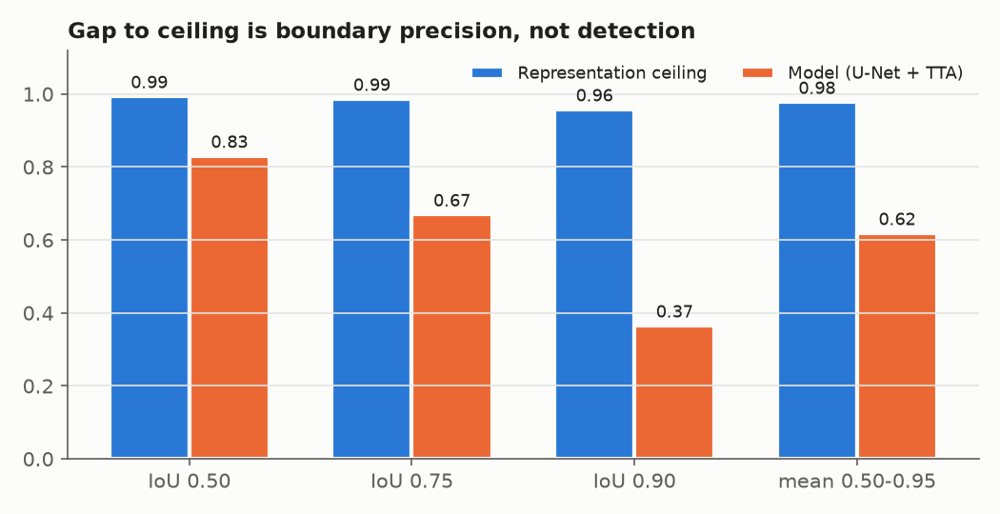
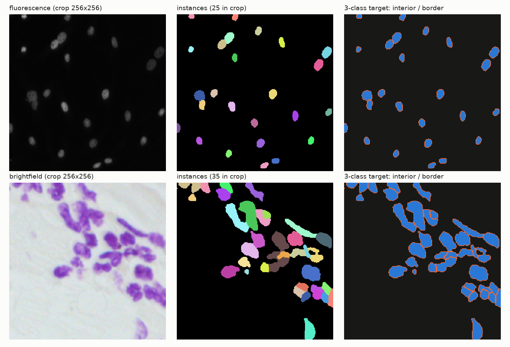
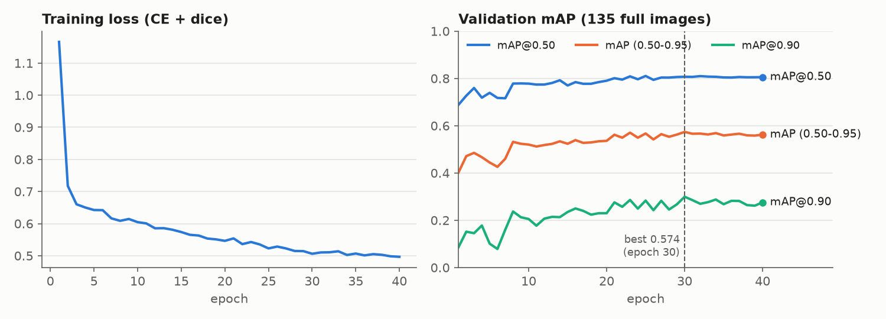
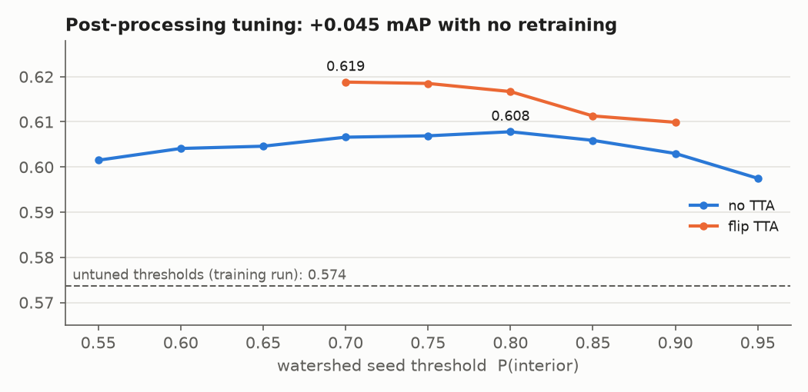

# Nuclei Instance Segmentation (Data Science Bowl 2018)

Finds and separates every cell nucleus in microscopy images, scored with the
competition's instance-level mAP.

The model is a U-Net with a pretrained ResNet34 encoder. It predicts three
classes per pixel (background / nucleus interior / nucleus border), and a seeded
watershed splits the result into individual nuclei. The pipeline is built from
scratch around what the data analysis showed, and each stage has its own tests.

| | Validation mAP (IoU 0.50-0.95) |
|---|---|
| Model, untuned post-processing (best epoch of 40) | 0.574 |
| + tuned watershed thresholds | 0.608 |
| + flip test-time augmentation | **0.619** |
| Upper bound of this target representation | 0.978 |

All scores are on 135 held-out full-resolution images, using the
competition's metric.





*Ground truth for two validation images. In the bottom image the nuclei touch.
A binary mask would merge them into one blob. The 3-class target puts a border
(orange) between them, and at inference the watershed uses it to split them
apart.*

<!-- predictions.png: run `python -m scripts.make_figures predictions --ckpt runs/run40/best.pt` on the GPU machine, then uncomment:

-->

## The problem

[Kaggle DSB 2018, stage 1](https://www.kaggle.com/c/data-science-bowl-2018):
670 training images and 29,461 annotated nuclei. The data is harder than it
looks:

- **Two imaging modalities.** 546 fluorescence images (bright nuclei on black)
  and 124 brightfield images (dark nuclei on light, inverted contrast).
- **Many sizes.** 9 resolutions, from 256x256 to 1040x1388.
- **Small objects.** The median nucleus is 19.7 px across, and 14.9% are under
  10 px. Downsampling would erase them.
- **Touching nuclei.** 78% of images contain touching nuclei (5,247 touching
  pairs). Plain foreground/background segmentation would merge them.

## Approach

**1. Data analysis drove the design** ([notebooks/01_eda.ipynb](notebooks/01_eda.ipynb), [src/eda_checks.py](src/eda_checks.py))

| Finding | Decision |
|---|---|
| Masks never overlap (0 shared pixels in the dataset) | Store one int label map per image instead of N binary masks (4 MB vs 375 MB at worst) |
| 78% of images have touching nuclei | 3-class target (interior / border / background) + watershed, not binary masks |
| The two modalities separate cleanly (k=2, silhouette 0.78); a background-median rule agrees on 670/670 | Invert brightfield images when loading. The rule needs no masks, so it also works at inference time |
| A random 80/20 split can leave only 15 of 124 brightfield images in validation | Split stratified by modality × resolution × density |
| Annotations are drawn ~1 px larger than the visible edge | High IoU thresholds have a natural ceiling, so measure that ceiling before blaming the model |

**2. Data pipeline** ([src/data_loader.py](src/data_loader.py), [src/dataset_manifest.py](src/dataset_manifest.py))

- Every image is decoded **once** into a `.npy` cache (image + label map +
  3-class target, 6 bytes/px). A training crop is then a memory copy, not a
  PNG decode.
- The 3-class target is computed on the **full** label map before cropping.
  Computing it per crop would create false borders along crop edges.
- Training samples **random 256×256 crops at native resolution**. The sampler
  has explicit settings for modality mix (65/35), image weight (∝ area^0.35)
  and crop centering (70% on a nucleus). Fixed tiling would let large
  brightfield images take over ~82% of each epoch.
- Augmentation is limited to flips and 90° rotations, so the cached target
  never has to be interpolated.

**3. Model and training** ([src/model.py](src/model.py), [src/losses.py](src/losses.py), [train.py](train.py))

- `segmentation_models_pytorch` U-Net, ResNet34 encoder pretrained on
  ImageNet, 24.4 M parameters.
- Loss: weighted cross-entropy (inverse square root of class frequency, since
  border pixels are only 2% of the data) + soft dice on the two foreground
  classes. Dice is computed in fp32 because it underflows under fp16 AMP.
- AdamW, warmup + cosine schedule via `LambdaLR`. The built-in
  `CosineAnnealingLR` shares one minimum learning rate across parameter
  groups, which silently erased the encoder/decoder learning-rate ratio.
- Data loading runs in a background thread overlapped with the GPU, making
  epochs 33% faster.

**4. Inference and scoring** ([src/inference.py](src/inference.py), [src/postprocess.py](src/postprocess.py), [src/metrics.py](src/metrics.py))

- Sliding window (256 px, stride 192) with Hann-weighted blending. Weights
  have a minimum of 0.05: pixels at the image edge are covered by a single
  tile, and a zero weight there would produce NaN.
- Watershed: seeds are pixels with high P(interior), and instances may only
  grow into pixels with low P(background).
- The metric follows the competition definition: precision is TP/(TP+FP+FN)
  at each IoU threshold, averaged per image. IoU for all instance pairs comes
  from a single `bincount` pass.

## Results



- 40 epochs × 3,000 crops took about 20 minutes on a Tesla T4. The best
  checkpoint is from epoch 30. Training loss kept falling after that, but
  validation mAP didn't improve, so more epochs at this setup won't help.
- Post-processing was tuned against cached probabilities: the model runs
  once, and each threshold setting only reruns the watershed. Every grid was
  widened until its best value was inside the grid rather than on an edge.



**Analysis**

- **The target representation isn't the limit.** Ground truth converted to
  the 3-class target and back through the watershed scores 0.978 mAP.
- **The model finds nuclei but doesn't trace their edges precisely enough.**
  It is at 0.83 vs 0.99 at IoU 0.50, but 0.37 vs 0.96 at IoU 0.90. Almost all
  remaining error is boundary precision.
- **Getting the nucleus count right isn't the goal.** Raising the seed
  threshold until the predicted count matches the ground truth lowers mAP
  (0.603 vs 0.608). The metric rewards precise matches, not correct totals.
- **The tuning results are flat near the best setting** (±0.002 across a wide
  range). The last few thousandths are fitted to the 135 validation images,
  so the reported operating point is the middle of that flat region.

**Next steps:** boundary-aware loss weighting, a higher dice weight, a lower
encoder learning-rate multiplier, and a longer schedule at low learning rate.

## Testing

| Suite | Checks | What it verifies |
|---|---|---|
| `scripts/verify_pipeline.py` | 56 | split is disjoint and complete; cache matches a fresh decode byte for byte; no two instances' interiors touch; augmentation keeps image, target and labels aligned; replays are deterministic |
| `scripts/test_metric_watershed.py` | 38 | metric on hand-built cases; IoU > 0.5 implies one-to-one matching; the 0.978 ceiling |
| `scripts/test_losses.py` | 31 | class weights; NaN-safe ignore mask; AMP dice equals fp32 dice |
| `scripts/test_inference.py` | 17 | a constant model stitches to the exact constant across seams; gradients stay monotonic both horizontally and vertically (catches transposed axes) |

## Reproduce

**On Google Colab (free GPU):**
[](https://colab.research.google.com/github/lina-dh/nuclei-segmentation-dsb2018/blob/main/notebooks/02_train_colab.ipynb)
runs everything from the data to the prediction figure in about 35 minutes.

**Locally:**

```bash
pip install -r requirements.txt

# 1. Download stage1_train.zip from Kaggle and extract it to data/stage1_train/
# 2. Build the decoded cache from the committed manifest (keeps the frozen split)
python -m scripts.build_cache

# 3. CPU checks
python -m scripts.verify_pipeline
python -m scripts.test_metric_watershed

# 4. Train (GPU)
python train.py --epochs 40 --crops-per-epoch 3000 --batch-size 16 --wandb-mode offline

# 5. Tune post-processing, then make figures
python -m scripts.sweep_postprocess --ckpt runs/<run>/best.pt --tta
python -m scripts.make_figures results
python -m scripts.make_figures predictions --ckpt runs/<run>/best.pt
```

`.project_state/manifest.json` is the frozen train/val split that every number
above refers to. Don't regenerate it: rerunning `build_manifest()` reassigns 7
samples to the other split.

## Layout

```
src/
  data_loader.py       loading, 3-class target, cache, crop sampler, augmentation
  dataset_manifest.py  per-sample stats + stratified split
  dataset_audit.py     integrity checks
  eda_checks.py        touching pairs, modality clustering, label-edge quality
  model.py             U-Net / ResNet34
  losses.py            weighted CE + soft dice
  inference.py         sliding window + Hann blending
  postprocess.py       watershed + tuned thresholds
  metrics.py           DSB 2018 mAP
train.py               training loop (AMP, AdamW, cosine, wandb)
scripts/               tests, cache builder, post-processing sweep, figures
.project_state/        frozen manifest, normalization/class stats, sweep results
notebooks/01_eda.ipynb
```
